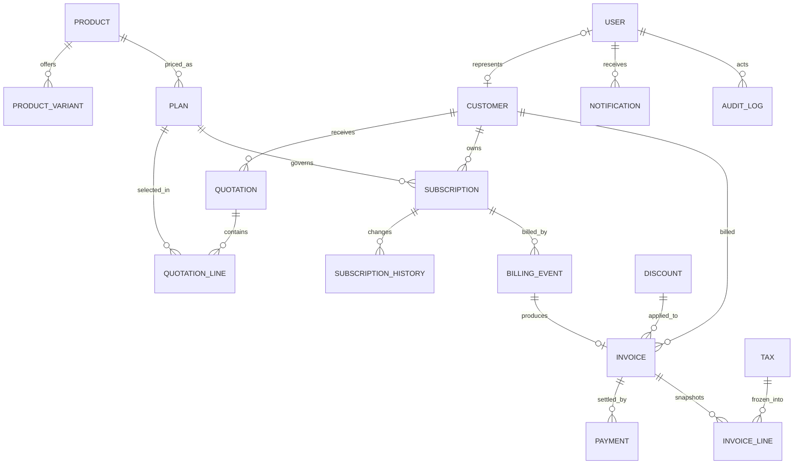

# Database relationships and invariants

## Relationship map

Quotation, invoice, and subscription lines are embedded value snapshots rather than live catalog references for pricing. Product, plan, customer, actor, and lifecycle references use ObjectIds. The diagram omits supporting indexes and embedded value objects for readability.

## Entity ownership and lifecycle

- A customer account is represented by one `User` with `role=CUSTOMER`; customer-facing requests resolve that mapping from the session.
- A quotation may become one subscription once, after acceptance and expiry checks. Rejected, expired, and converted quotations cannot be converted again.
- A subscription has one plan reference for current policy and immutable contracted line pricing; history records each state transition.
- A billing event is the durable record of an attempt for one subscription period. It may have one invoice; retries reuse its idempotency identity.
- An invoice owns the frozen financial lines and totals. Payments reference the invoice and are append-only financial events; balance/status are reconciled from successful allocations.
- Tax and discount configuration can change over time. Their applied rates/amounts are copied into invoice snapshots so prior bills remain explainable.

| Model | Key relationships | Essential constraints / indexes |
|---|---|---|
| User | optional customer identity, role | unique normalized email; role |
| Customer | user, subscriptions, invoices, payments | normalized email; status + createdAt |
| Product / ProductVariant | catalog and variants | unique `{productId, normalizedName}` variant |
| Plan | product | product + status + availability dates |
| Quotation / Template | customer and product/plan lines | unique quotation number; status + expiry |
| Subscription / History | customer, plan, immutable line snapshot | unique subscription number; status + nextBillingDate |
| Tax / Discount | applicability, date windows | unique normalized tax/code; active period |
| Invoice | customer, subscription, snapshot | unique invoice number and unique subscription billing period |
| Payment | customer, invoice | unique payment reference; invoice + paymentDate |
| BillingEvent | subscription, period | unique idempotency key; retry state |
| Notification / AuditLog | recipient / actor + target | recipient + readAt; target + createdAt |

`User(role=CUSTOMER)` maps to one customer identity. Customer ownership is enforced by user/customer linkage, not submitted IDs. Catalog records remain references; quotations, subscriptions, and invoices store only necessary financial snapshots (name, price, quantity, tax, discount, totals). A confirmed invoice stays immutable except for audited payment roll-ups and permitted cancellation.

Financial values use integer minor currency units (paise) plus currency (initially INR), never floating point.

## Transaction boundaries

| Operation | Atomic records |
|---|---|
| Accepted quotation conversion | quotation, subscription, history, audit |
| Billing a period | billing event, invoice, subscription date/history, notification outbox |
| Payment recording | payment, invoice balances/state, audit |
| Limited coupon redemption | discount counter, invoice snapshot, billing event |

Mongo transactions and unique indexes work together to make concurrent requests safe.
